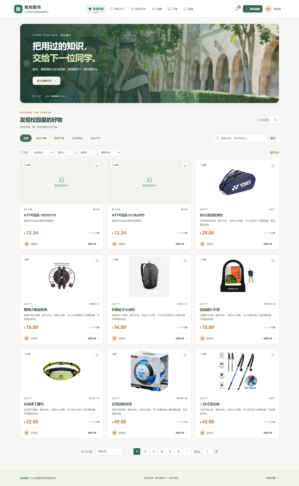

# 拾光集市 · 校园二手交易

保留校园商品、求购、收藏、咨询和管理页面，将旧版演示身份头与H2运行方式迁移为可信Session、MySQL意向交易和独立站内通知。交易仅记录线下面交意向，不处理真实资金。

技术：Java 17、Spring Boot 3.5.16、MyBatis 3.0.5、MySQL 8.0、Redis / Spring Session、Spring Cloud 2025.0.2、Gateway Server Web MVC、OpenFeign、Vue 3 / JavaScript、Element Plus、原生Fetch、Docker Compose。没有JWT、完整Spring Security登录体系、注册中心或分布式事务框架。

## 启动

需要Docker及Compose v2。在项目根目录：

```sh
python scripts/create_env.py
# 如需演示数据，在 .env 中设置 MARKET_PROFILES=demo；仅允许空数据库首次初始化。
docker compose up -d --build
```

访问 [拾光集市](http://127.0.0.1:15173)。首次构建会下载依赖并编译三个Java模块；查看 `docker compose logs -f market gateway notice`。正式使用保持默认profile，使用注册页面创建普通账号，由受控数据库操作授予首个管理员；不要启用公开演示账号。

仅demo profile创建 `student / 123456`、`zhou / 123456`、`admin / admin123` 等36个固定演示账号、78件商品及原有分页案例。正式启动不会导入案例或重置数据。

MySQL与Redis分别绑定本机13319 / 16379；只有网关18080和网页15173发布到主机。market和notice无Compose主机端口；独立schema、独立凭据，uploads使用持久卷。`docker compose stop`停止服务，`docker compose start`继续使用原数据。不要使用删除卷的命令代替停止。

## 本地开发与验证

先通过Compose启动MySQL和Redis，设置 `.env` 对应的数据库密码、Redis密码以及 `NOTICE_INTERNAL_TOKEN` 到当前终端环境。开发默认 market18084、notice18085、gateway18080，均绑定127.0.0.1。保留原Vue15173及同源代理。

```sh
mvn -B -ntp verify
java -jar notice-service/target/notice-service-1.0.0-SNAPSHOT.jar
java -jar server/target/market-service-1.0.0-SNAPSHOT.jar
java -jar gateway/target/gateway-1.0.0-SNAPSHOT.jar
npm --prefix web ci
npm --prefix web run dev
```

Maven测试要求独立 `market_test` / `notice_test` schema及Redis。测试配置变量和建库过程见 [.github/workflows/ci.yml](.github/workflows/ci.yml)；数据库必须是隔离测试库，测试会新增数据。源码中不再包含H2运行或测试依赖。

```sh
python -m unittest discover -s scripts -p test_migration.py
node scripts/test_api.mjs
npm --prefix web run build
# 设置隔离数据库连接后，脚本自行启动/停止真实Java进程：
python scripts/smoke_services.py
# 对已启动的专用Compose测试环境进行停机/重启故障测试：
python scripts/smoke_services.py --compose
```

HTTP回归会创建测试商品和意向，Compose故障测试会重启该测试栈的通知、MySQL和Redis，请在隔离测试环境运行。浏览器回归 `node scripts/check_migration_ui.cjs <playwright模块路径>`，保留原注册和42张轮播回归脚本。

## 功能与边界

- Session认证、CSRF、改密/停用/角色变化使旧会话失效；所有权限取数据库，客户端用户缓存仅用于显示。
- 商品发布、编辑、上下架、图片上传和预览、多条件筛选、收藏显式PUT/DELETE；归属始终使用用户ID。
- 购买意向：买家发起 → 卖家确认 → 买家确认线下交接。确认前买家可取消或卖家可拒绝；确认后由管理员说明原因关闭。
- 订单、商品预留、Outbox在同一MySQL事务中；固定加锁顺序和数据库唯一索引处理并发与重复提交。
- 原13个数据库分页列表、咨询回复、求购审核、举报、用户管理及概览保留；新增通知列表、未读角标、失败事件补投和管理日志。
- Redis共享Session与30—40秒公开商品详情缓存。缓存失败可回源，Session故障返回503；缓存不参与成交决策。
- 保留原78张商品图片、42张轮播图及来源清单。新上传JPG/PNG实际解码并限制2000万像素、5MB；选择WebP时由浏览器转PNG，后端重新验证。

原设计文字中提到的分类管理、公告、头像/手机号并无对应完整模块，本次没有新增或声称存在。没有钱包、支付、退款、物流、短信、邮件、WebSocket或生产规模性能承诺。

## 文档与证据

- [系统设计与交易状态图](docs/系统设计方案.md)
- [API与权限](docs/API.md) · [数据字典](docs/DATA_DICTIONARY.md)
- [迁移、身份映射与冲突处理](docs/MIGRATION.md) · [已知fixture迁移报告](docs/fixture-migration-report.json)
- [启停、故障处理、备份与回退](docs/OPERATIONS.md)
- [实际验证记录](docs/VALIDATION.md) · [面试说明](docs/INTERVIEW.md) · [简历描述](docs/简历项目介绍.md)



旧版基线保留为提交 `d650859979324881753cf306c9c1cf2b8549de6c`；本轮为2026-10-24个人改造，不补造过去的开发时间、用户量、支付规模或部署业绩。
