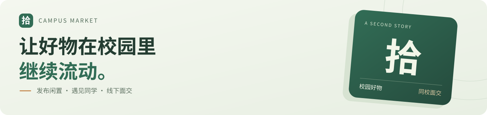
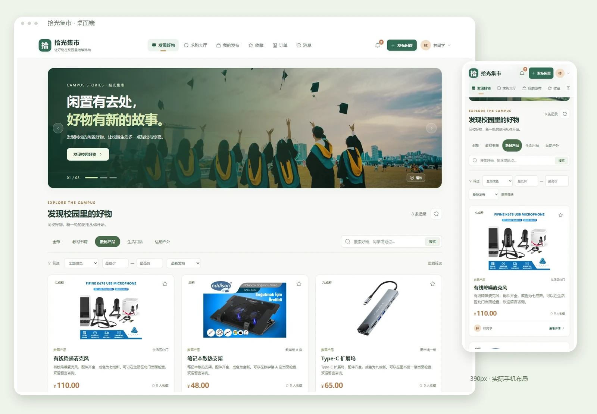
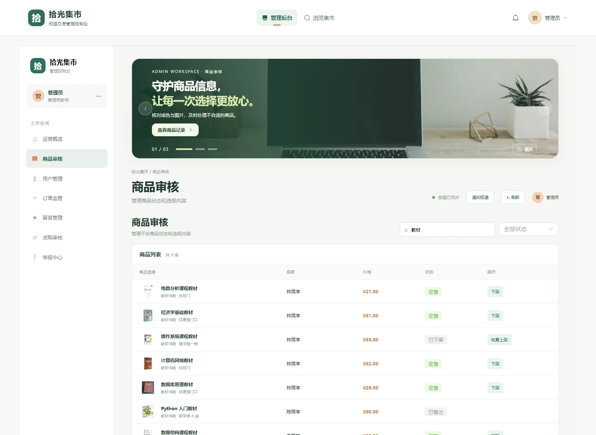
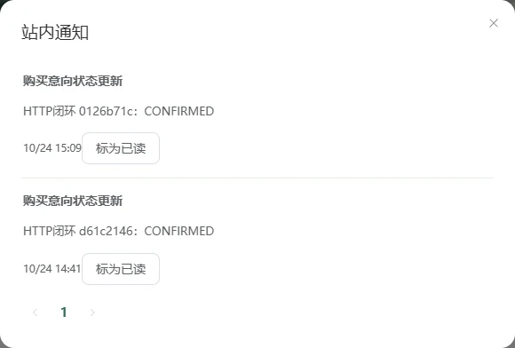
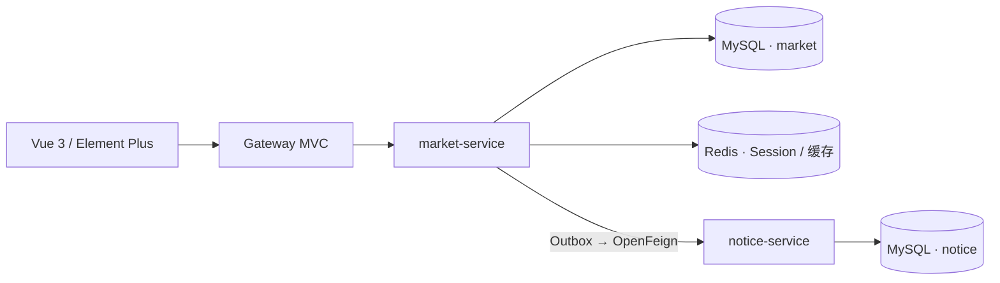

<p align="center">
  
</p>

<h1 align="center">拾光集市 · 校园二手交易</h1>

<p align="center">
  发布一件闲置，遇见需要它的同学。<br />
  商品浏览、购买意向、求购与咨询，连接校园里的每一次好物交接。
</p>

<p align="center">
  <a href="https://github.com/17elr/campus-secondhand-system/actions/workflows/ci.yml"></a>
  <a href="pom.xml"></a>
  <a href="pom.xml"></a>
  <a href="web/package.json"></a>
  <a href="compose.yaml"></a>
</p>

<p align="center">
  <a href="#快速启动">快速启动</a> ·
  <a href="#页面预览">页面预览</a> ·
  <a href="docs/README.md">文档中心</a> ·
  <a href="docs/VALIDATION.md">验证记录</a>
</p>

## 页面预览



<table>
  <tr>
    <td width="62%"><a href="docs/GALLERY.md#管理后台"></a></td>
    <td width="38%"><a href="docs/GALLERY.md#站内通知"></a></td>
  </tr>
  <tr>
    <td align="center">管理后台 · 商品筛选与审核</td>
    <td align="center">站内通知 · 交易进展及时查看</td>
  </tr>
</table>

以上为运行中的真实页面，使用本地演示数据。[查看大图与页面说明 →](docs/GALLERY.md)

## 可以做什么

| 场景 | 已实现的体验 |
| --- | --- |
| 发现好物 | 关键词、分类、成色、价格筛选，排序、分页、详情与收藏 |
| 发布闲置 | 图片上传与预览，编辑、上架和下架自己的商品 |
| 线下交接 | 买家发起意向 → 卖家确认 → 买家确认交接，支持取消与异常关闭 |
| 校园互助 | 求购发布、编辑、撤回、已找到与管理员审核 |
| 咨询与通知 | 商品咨询、卖家回复、站内通知列表和未读角标 |
| 平台管理 | 商品、用户、意向、求购、留言、举报管理，投递补发与操作留痕 |

交易使用线下购买意向流程，不接入真实支付。

## 快速启动

准备 **Docker、Compose v2 和 Python 3**，在终端执行：

```sh
git clone https://github.com/17elr/campus-secondhand-system.git
cd campus-secondhand-system
python scripts/create_env.py
```

首次体验时，在生成的 `.env` 中设置 `MARKET_PROFILES=demo`，然后启动：

```sh
docker compose up -d --build
```

打开 [本机集市 · http://127.0.0.1:15173](http://127.0.0.1:15173)。首次构建需要下载依赖并编译服务。

| 演示角色 | 用户名 | 密码 |
| --- | --- | --- |
| 普通用户 | `student` | `123456` |
| 卖家示例 | `zhou` | `123456` |
| 管理员 | `admin` | `admin123` |

演示账号与案例仅由 `demo` profile 在空数据库中初始化；正式使用保持默认 profile。数据保存在持久卷中，停止与恢复使用 `docker compose stop` / `docker compose start`。

[完整启动说明](docs/QUICKSTART.md) · [不使用 Docker 的本地开发](docs/DEVELOPMENT.md) · [备份与回退](docs/OPERATIONS.md)

## 系统架构



三个 Java 进程分别负责统一入口、交易核心和站内通知。商品、意向与 Outbox 保持在同一个 MySQL 事务中；通知在事务提交后投递，服务停机时可以补投。两个 schema 在开发环境中共享一个 MySQL 实例。

| 层次 | 当前技术 |
| --- | --- |
| 界面 | Vue 3、JavaScript、Vite、Element Plus、原生 Fetch |
| 业务 | Java 17、Spring Boot 3.5.16、Spring MVC、MyBatis 3.0.5 |
| 数据与认证 | MySQL 8.0、Redis、Spring Session、CSRF、BCrypt |
| 服务与交付 | Spring Cloud 2025.0.2、Gateway Server Web MVC、OpenFeign、Docker Compose |

[服务边界与交易状态图 →](docs/系统设计方案.md)

## 值得查看的实现

- **身份可信**：服务端 Session 恢复登录，按用户 ID 判断归属；改密、停用和角色变化使旧会话失效。
- **交易一致**：固定行锁顺序、请求幂等键、活动意向唯一索引；创建意向、预留商品和写入 Outbox 一起提交或回滚。
- **通知可恢复**：独立通知服务、事件幂等、持久租约、有限重试和管理员补投；远程调用不占用交易行锁。
- **迁移可核查**：默认只审计，使用显式身份映射，保留未核对记录；校验行数、金额、ID、时间精度和图片路径。

## 验证与文档

截至 **2026-10-24**，38 项 Java 测试通过，已完成浏览器回归、真实 MySQL / Redis 服务联调和 Compose 故障恢复验收。测试数量与结果见 [测试记录](docs/test-results.json)，完整范围见 [验证说明](docs/VALIDATION.md)。

| 阅读目标 | 文档入口 |
| --- | --- |
| 运行与开发 | [快速上手](docs/QUICKSTART.md) · [本地开发](docs/DEVELOPMENT.md) |
| 设计与接口 | [系统设计](docs/系统设计方案.md) · [API 与权限](docs/API.md) · [数据字典](docs/DATA_DICTIONARY.md) |
| 数据与维护 | [数据迁移](docs/MIGRATION.md) · [运行维护](docs/OPERATIONS.md) |
| 验证与讲解 | [实际验证](docs/VALIDATION.md) · [面试说明](docs/INTERVIEW.md) |

<details>
<summary>项目目录与实现范围</summary>

```text
campus-secondhand-system/
├── web/              Vue 页面与静态素材
├── gateway/          Spring Cloud Gateway MVC
├── server/           market-service：认证与交易核心
├── notice-service/   独立站内通知服务
├── infra/            MySQL 初始化与 CI 数据库配置
├── scripts/          凭据生成、迁移与验证工具
├── docs/             设计、运行、验证及真实截图
└── compose.yaml      六个服务与持久卷
```

当前未包含钱包、真实付款、退款、物流、短信邮件、WebSocket、分类管理或公告模块。项目为毕业设计基础上的个人改造，不声明生产部署规模、用户量或未经验证的性能提升。

旧基线与改造过程均保留在 Git 历史中，见 [首次改造 PR](https://github.com/17elr/campus-secondhand-system/pull/1)。

</details>

商品及轮播图片沿用项目原有素材，来源见 [图片清单](web/public/images/manifest.json)。
