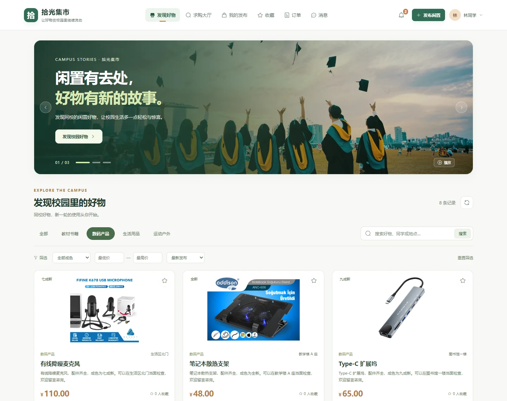
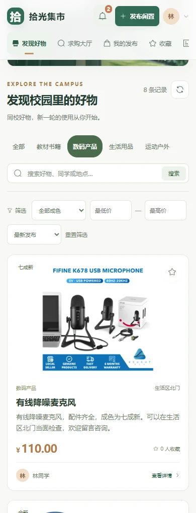

# 页面预览

[项目首页](../README.md) · [文档中心](README.md) · [快速体验](QUICKSTART.md)

以下截图采集于 2026-10-24，来自运行中的 Vue 页面与本地演示数据。商品页展示数码分类，后台展示教材筛选；没有替换页面内容或拼造功能。

## 校园集市

分类、关键词、成色、价格和排序在同一页面完成。商品卡片保留独立图片、卖家、面交地点与收藏入口。

## 手机布局

390px 视口中的商品浏览。下图为实际滚动后的页面，可看到导航、筛选与商品卡片。

## 管理后台

左侧导航覆盖概览、商品、用户、意向、留言、求购和举报；当前页面展示商品查询与审核列表。

## 站内通知

交易进度与回复以站内通知呈现，包含未读状态和标记已读操作。

通知服务故障时保留旧列表并显示错误，原故障截图与测试过程见 [验证记录](VALIDATION.md)。
