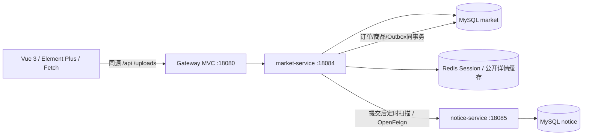
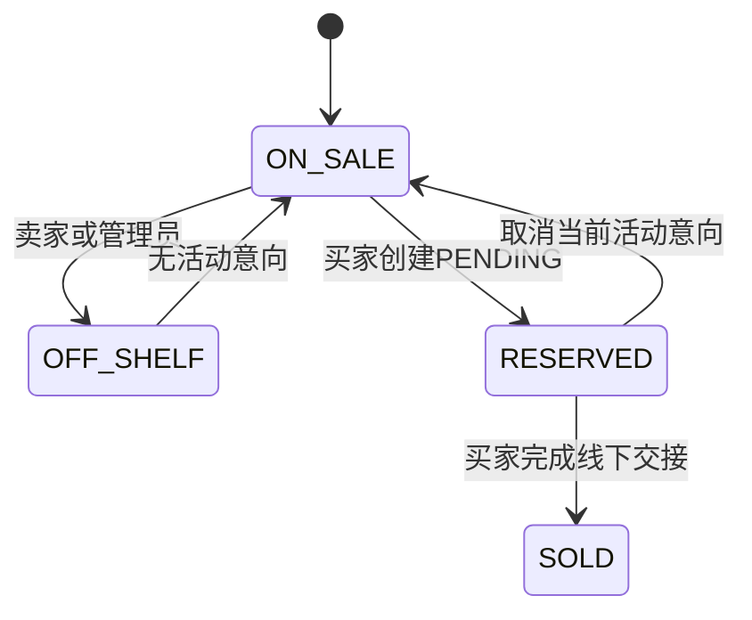
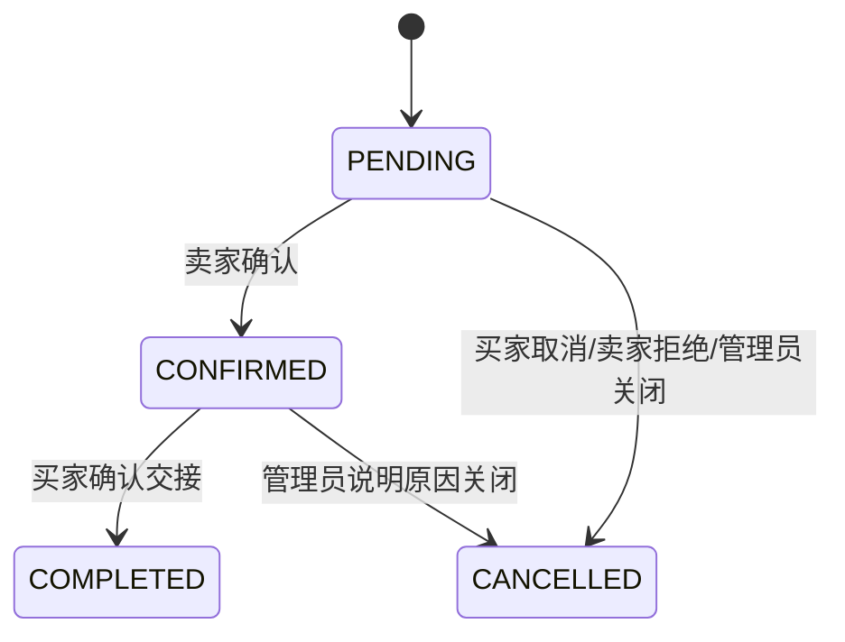

# 拾光集市系统设计（2026-10-24改造）

## 服务边界

保留 `server` 目录承载market领域，不拆商品与订单。通知使用独立schema、独立数据库账号及HTTP契约，不读取market表，不共享实体、会话或跨库外键。本地Compose复用一个MySQL实例，不宣称独立数据库集群。

Gateway使用Servlet Web MVC路由API与uploads，透传Cookie、移除自报身份头，限制请求大小并生成请求ID。`/internal`不对外路由。market仍独立执行认证、CSRF、角色和资源归属校验，因此绕过网关也不能通过伪造身份头授权。

## 认证与权限

BCrypt校验密码，Redis中Session保存userId、authVersion和CSRF令牌。登录更换sessionId及CSRF令牌；每次请求查询数据库当前角色和状态。改密、角色调整、启停账号递增auth_version，旧会话下一请求失效。Cookie为HttpOnly / SameSite=Lax，HTTPS部署启用Secure。

所有写操作（含注册、登录、退出）验证X-CSRF-Token。Vue启动调用me恢复真实身份，localStorage仅保留显示缓存。公开浏览只提供在售商品和已发布求购，不返回密码哈希、联系方式或内部处理原因。管理日志与Outbox只允许管理员查询。RedisSession不可用时503；公开缓存失败可查询MySQL。

## 交易状态

创建和转换统一按买家用户行 → 商品行 → 订单行加锁。锁前查询只取不可变关联ID。相同buyer_id+request_key查询已创建结果；参数Hash不同返回409。插入订单后，商品条件更新必须影响1行，再写Outbox，任一步失败整体回滚。

MySQL生成列active_goods_id只为已核对的PENDING/CONFIRMED订单生成商品ID，唯一索引约束每件商品最多一个可信活动意向。旧版冲突数据保留并标记只读，不能为创建索引而删除订单。取消和完成必须匹配商品reserved_order_id；完成后的商品不能被旧取消请求重新上架。

## 其他领域

收藏先锁商品，检查关系是否变化，再同事务更新计数；显式PUT/DELETE可重复调用。咨询与回复使用卖家ID判断，业务和通知事件同事务。求购编辑回到PENDING；FOUND/WITHDRAWN不能被管理员再次公开。

所有列表在MySQL内先筛选再LIMIT/OFFSET，列表和count复用过滤条件，排序追加ID保证稳定；PageQuery校验分页、状态、价格和排序白名单。

## 通知交付

Outbox每5秒扫描，短事务使用FOR UPDATE SKIP LOCKED认领，租约15秒。HTTP在交易锁外执行；Feign连接1秒、读取3秒，Retryer.NEVER_RETRY。投递次数与状态持久化，失败间隔5/30/120秒，最多3次后FAILED（第三次失败结束重试，120秒时间仅保留为下次计划字段）；管理员可说明原因补投。

事件ID重试时不变，notice用(event_id,recipient_id)唯一键及规范化payload Hash检查幂等；相同内容返回同一个通知ID，异内容409。进程在远端成功后本地确认前崩溃可能重复投递，唯一约束负责去重。过期租约可重新认领，最终尝试的租约失效后标记FAILED。通知故障不回滚交易；通知列表失败503，前端显示错误并保留旧列表。

## 界面

复用原绿色校园视觉、Vue页面和Element Plus组件，增加站内通知和失败补投弹窗、卖家确认与买家交接按钮、昵称及密码表单。移除Axios及自报身份头，Fetch统一处理Cookie/CSRF/JSON/FormData和状态错误。保留原商品/轮播素材与来源，小屏改为单列及可滚动导航，键盘焦点和错误提示保留。

[Spring Boot 3.5系统要求](https://docs.spring.io/spring-boot/3.5/system-requirements.html)、[Spring Cloud 2025.0.2发布说明](https://spring.io/blog/2026/04/02/spring-cloud-2025-0-2-aka-northfields-has-been-released/)、[Gateway MVC](https://docs.spring.io/spring-cloud-gateway/reference/spring-cloud-gateway-server-webmvc.html)、[Spring Session](https://docs.spring.io/spring-session/reference/http-session.html)。版本由Boot父POM与Cloud BOM管理。
